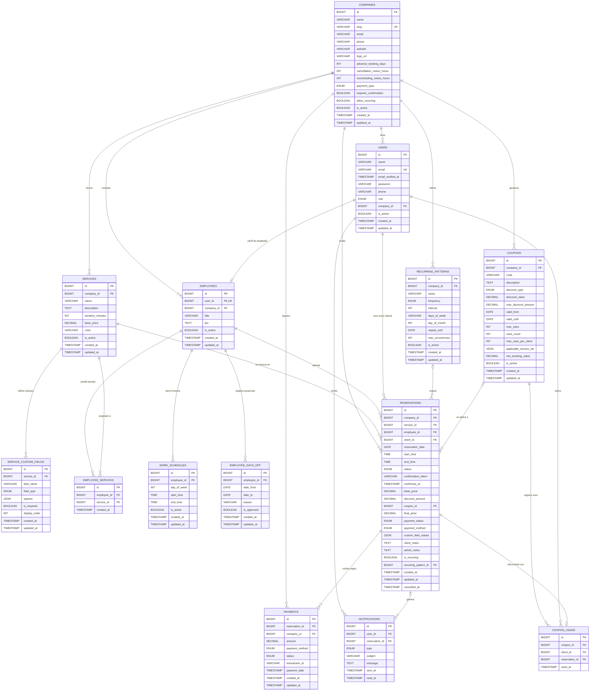

# Arquitectura de Base de Datos
## Sistema de Reservas Multiempresa

---

## TABLAS Y CAMPOS

### 1. USERS (Usuarios del Sistema)
| Campo | Tipo | Descripción |
|-------|------|-------------|
| id | BIGINT | ID único |
| name | VARCHAR(255) | Nombre completo |
| email | VARCHAR(255) | Email único |
| email_verified_at | TIMESTAMP | Verificación de email |
| password | VARCHAR(255) | Contraseña hasheada |
| phone | VARCHAR(20) | Teléfono |
| role | ENUM | super_admin, admin, employee, client |
| company_id | BIGINT | Relación con empresa |
| is_active | BOOLEAN | Estado activo/inactivo |
| created_at | TIMESTAMP | Fecha creación |
| updated_at | TIMESTAMP | Fecha actualización |

**Relaciones:**
- ➜ company (pertenece a)
- ➜ employee (tiene uno)
- ➜ reservations (crea múltiples como cliente)
- ➜ notifications (recibe múltiples)

---

### 2. COMPANIES (Empresas)
| Campo | Tipo | Descripción |
|-------|------|-------------|
| id | BIGINT | ID único |
| name | VARCHAR(255) | Nombre empresa |
| slug | VARCHAR(255) | URL amigable |
| email | VARCHAR(255) | Email empresa |
| phone | VARCHAR(20) | Teléfono |
| website | VARCHAR(255) | Sitio web |
| logo_url | VARCHAR(255) | URL del logo |
| advance_booking_days | INT | Días de anticipación para reservar |
| cancellation_notice_hours | INT | Horas previas para cancelar |
| rescheduling_notice_hours | INT | Horas previas para reprogramar |
| payment_type | ENUM | manual, banco |
| requires_confirmation | BOOLEAN | Confirmación doble requerida |
| allow_recurring | BOOLEAN | Permite reservas recurrentes |
| is_active | BOOLEAN | Estado activo |
| created_at | TIMESTAMP | Fecha creación |
| updated_at | TIMESTAMP | Fecha actualización |

**Relaciones:**
- ➜ users (tiene múltiples)
- ➜ employees (tiene múltiples)
- ➜ services (ofrece múltiples)
- ➜ reservations (tiene múltiples)
- ➜ coupons (tiene múltiples)
- ➜ payments (registra múltiples)
- ➜ recurring_patterns (define múltiples)

---

### 3. SERVICES (Servicios)
| Campo | Tipo | Descripción |
|-------|------|-------------|
| id | BIGINT | ID único |
| company_id | BIGINT | Empresa que ofrece |
| name | VARCHAR(255) | Nombre servicio |
| description | TEXT | Descripción |
| duration_minutes | INT | Duración en minutos |
| base_price | DECIMAL(10,2) | Precio base |
| color | VARCHAR(7) | Color para calendario (HEX) |
| is_active | BOOLEAN | Estado |
| created_at | TIMESTAMP | Fecha creación |
| updated_at | TIMESTAMP | Fecha actualización |

**Relaciones:**
- ➜ company (pertenece a)
- ➜ employees (múltiples pueden prestarlo)
- ➜ reservations (tiene múltiples)
- ➜ custom_fields (tiene múltiples campos personalizados)

---

### 4. SERVICE_CUSTOM_FIELDS (Campos Personalizados)
| Campo | Tipo | Descripción |
|-------|------|-------------|
| id | BIGINT | ID único |
| service_id | BIGINT | Servicio propietario |
| field_name | VARCHAR(255) | Nombre del campo |
| field_type | ENUM | text, textarea, email, phone, select, checkbox, date |
| options | JSON | Opciones para select/checkbox |
| is_required | BOOLEAN | Campo obligatorio |
| display_order | INT | Orden de visualización |
| created_at | TIMESTAMP | Fecha creación |
| updated_at | TIMESTAMP | Fecha actualización |

**Relaciones:**
- ➜ service (pertenece a)

---

### 5. EMPLOYEES (Empleados)
| Campo | Tipo | Descripción |
|-------|------|-------------|
| id | BIGINT | ID único |
| user_id | BIGINT | Usuario asociado (único) |
| company_id | BIGINT | Empresa empleadora |
| title | VARCHAR(255) | Título/puesto |
| bio | TEXT | Biografía |
| is_active | BOOLEAN | Estado |
| created_at | TIMESTAMP | Fecha creación |
| updated_at | TIMESTAMP | Fecha actualización |

**Relaciones:**
- ➜ user (tiene uno)
- ➜ company (pertenece a)
- ➜ services (puede prestar múltiples)
- ➜ work_schedules (tiene múltiples)
- ➜ days_off (tiene múltiples)
- ➜ reservations (tiene múltiples como prestador)

---

### 6. EMPLOYEE_SERVICES (Servicios del Empleado)
| Campo | Tipo | Descripción |
|-------|------|-------------|
| id | BIGINT | ID único |
| employee_id | BIGINT | Empleado |
| service_id | BIGINT | Servicio |
| created_at | TIMESTAMP | Fecha creación |

**Relaciones:**
- ➜ employee (pertenece a)
- ➜ service (pertenece a)
- Nota: Tabla de relación N:N

---

### 7. WORK_SCHEDULES (Horarios de Trabajo)
| Campo | Tipo | Descripción |
|-------|------|-------------|
| id | BIGINT | ID único |
| employee_id | BIGINT | Empleado |
| day_of_week | INT | 0=Dom, 1=Lun, ... 6=Sab |
| start_time | TIME | Hora inicio |
| end_time | TIME | Hora fin |
| is_active | BOOLEAN | Estado |
| created_at | TIMESTAMP | Fecha creación |
| updated_at | TIMESTAMP | Fecha actualización |

**Relaciones:**
- ➜ employee (pertenece a)

---

### 8. EMPLOYEE_DAYS_OFF (Días Libres/Vacaciones)
| Campo | Tipo | Descripción |
|-------|------|-------------|
| id | BIGINT | ID único |
| employee_id | BIGINT | Empleado |
| date_from | DATE | Fecha inicio |
| date_to | DATE | Fecha fin |
| reason | VARCHAR(255) | Motivo |
| is_approved | BOOLEAN | Aprobado |
| created_at | TIMESTAMP | Fecha creación |
| updated_at | TIMESTAMP | Fecha actualización |

**Relaciones:**
- ➜ employee (pertenece a)

---

### 9. RESERVATIONS (Reservas - Principal)
| Campo | Tipo | Descripción |
|-------|------|-------------|
| id | BIGINT | ID único |
| company_id | BIGINT | Empresa |
| service_id | BIGINT | Servicio reservado |
| employee_id | BIGINT | Empleado asignado |
| client_id | BIGINT | Cliente que reserva |
| reservation_date | DATE | Fecha de reserva |
| start_time | TIME | Hora inicio |
| end_time | TIME | Hora fin |
| status | ENUM | pending_confirmation, confirmed, cancelled, completed, no_show |
| confirmation_token | VARCHAR(255) | Token para confirmación doble |
| confirmed_at | TIMESTAMP | Fecha de confirmación |
| base_price | DECIMAL(10,2) | Precio base |
| discount_amount | DECIMAL(10,2) | Descuento aplicado |
| coupon_id | BIGINT | Cupón usado (opcional) |
| final_price | DECIMAL(10,2) | Precio final |
| payment_status | ENUM | pending, paid, partial, refunded |
| payment_method | ENUM | cash, card, bank_transfer |
| custom_field_values | JSON | Datos de campos personalizados |
| client_notes | TEXT | Notas del cliente |
| admin_notes | TEXT | Notas del administrador |
| is_recurring | BOOLEAN | Es parte de patrón recurrente |
| recurring_pattern_id | BIGINT | Patrón recurrente (opcional) |
| created_at | TIMESTAMP | Fecha creación |
| updated_at | TIMESTAMP | Fecha actualización |
| cancelled_at | TIMESTAMP | Fecha cancellación |

**Relaciones:**
- ➜ company (pertenece a)
- ➜ service (pertenece a)
- ➜ employee (pertenece a)
- ➜ client/user (pertenece a)
- ➜ coupon (usa - opcional)
- ➜ payments (tiene múltiples)
- ➜ notifications (genera múltiples)
- ➜ recurring_pattern (parte de - opcional)

---

### 10. RECURRING_PATTERNS (Patrones de Recurrencia)
| Campo | Tipo | Descripción |
|-------|------|-------------|
| id | BIGINT | ID único |
| company_id | BIGINT | Empresa |
| name | VARCHAR(255) | Nombre del patrón |
| frequency | ENUM | daily, weekly, biweekly, monthly |
| interval | INT | Cada cuántos períodos (1, 2, etc) |
| days_of_week | VARCHAR(255) | Días [0,1,2,3,4,5,6] en JSON |
| day_of_month | INT | Día del mes (si es monthly) |
| repeat_until | DATE | Hasta cuándo repetir |
| max_occurrences | INT | Máximo de ocurrencias |
| is_active | BOOLEAN | Estado |
| created_at | TIMESTAMP | Fecha creación |
| updated_at | TIMESTAMP | Fecha actualización |

**Relaciones:**
- ➜ company (pertenece a)
- ➜ reservations (genera múltiples)

---

### 11. COUPONS (Cupones y Descuentos)
| Campo | Tipo | Descripción |
|-------|------|-------------|
| id | BIGINT | ID único |
| company_id | BIGINT | Empresa propietaria |
| code | VARCHAR(50) | Código único |
| description | TEXT | Descripción |
| discount_type | ENUM | percentage, fixed |
| discount_value | DECIMAL(10,2) | Valor descuento |
| max_discount_amount | DECIMAL(10,2) | Límite si es porcentaje |
| valid_from | DATE | Válido desde |
| valid_until | DATE | Válido hasta |
| max_uses | INT | Usos máximos totales |
| uses_count | INT | Usos realizados |
| max_uses_per_client | INT | Máximo usos por cliente |
| applicable_service_ids | JSON | Servicios aplicables (NULL = todos) |
| min_booking_value | DECIMAL(10,2) | Valor mínimo de reserva |
| is_active | BOOLEAN | Estado |
| created_at | TIMESTAMP | Fecha creación |
| updated_at | TIMESTAMP | Fecha actualización |

**Relaciones:**
- ➜ company (pertenece a)
- ➜ coupon_usage (registra múltiples usos)
- ➜ reservations (aplicado en múltiples)

---

### 12. COUPON_USAGE (Registro de Uso de Cupones)
| Campo | Tipo | Descripción |
|-------|------|-------------|
| id | BIGINT | ID único |
| coupon_id | BIGINT | Cupón usado |
| client_id | BIGINT | Cliente que lo usó |
| reservation_id | BIGINT | Reserva donde se usó |
| used_at | TIMESTAMP | Cuándo se usó |

**Relaciones:**
- ➜ coupon (pertenece a)
- ➜ client/user (pertenece a)
- ➜ reservation (pertenece a)

---

### 13. PAYMENTS (Pagos)
| Campo | Tipo | Descripción |
|-------|------|-------------|
| id | BIGINT | ID único |
| reservation_id | BIGINT | Reserva asociada |
| company_id | BIGINT | Empresa |
| amount | DECIMAL(10,2) | Monto pagado |
| payment_method | ENUM | cash, card, bank_transfer |
| status | ENUM | pending, completed, failed, refunded |
| transaction_id | VARCHAR(255) | ID de transacción |
| payment_date | TIMESTAMP | Fecha del pago |
| created_at | TIMESTAMP | Fecha registro |
| updated_at | TIMESTAMP | Última actualización |

**Relaciones:**
- ➜ reservation (pertenece a)
- ➜ company (pertenece a)

---

### 14. NOTIFICATIONS (Notificaciones)
| Campo | Tipo | Descripción |
|-------|------|-------------|
| id | BIGINT | ID único |
| user_id | BIGINT | Usuario destinatario |
| reservation_id | BIGINT | Reserva asociada (opcional) |
| type | ENUM | reservation_confirmed, reservation_cancelled, reservation_reminder, payment_received, confirmation_required, reservation_rescheduled |
| subject | VARCHAR(255) | Asunto email |
| message | TEXT | Cuerpo del mensaje |
| sent_at | TIMESTAMP | Fecha envío |
| read_at | TIMESTAMP | Fecha lectura (opcional) |

**Relaciones:**
- ➜ user (pertenece a)
- ➜ reservation (pertenece a - opcional)

---

## DIAGRAMA DE MI ARQUITECTURA



## DIAGRAMA DE RELACIONES

```
COMPANIES
    ├─ (1:N) → USERS
    ├─ (1:N) → EMPLOYEES
    ├─ (1:N) → SERVICES
    ├─ (1:N) → RESERVATIONS
    ├─ (1:N) → COUPONS
    ├─ (1:N) → PAYMENTS
    └─ (1:N) → RECURRING_PATTERNS

EMPLOYEES
    ├─ (N:1) → USERS
    ├─ (N:1) → COMPANIES
    ├─ (N:N) → SERVICES (employee_services)
    ├─ (1:N) → WORK_SCHEDULES
    ├─ (1:N) → EMPLOYEE_DAYS_OFF
    └─ (1:N) → RESERVATIONS (como prestador)

SERVICES
    ├─ (N:1) → COMPANIES
    ├─ (N:N) → EMPLOYEES (employee_services)
    ├─ (1:N) → SERVICE_CUSTOM_FIELDS
    └─ (1:N) → RESERVATIONS

RESERVATIONS (Centro del Sistema)
    ├─ (N:1) → COMPANIES
    ├─ (N:1) → SERVICES
    ├─ (N:1) → EMPLOYEES
    ├─ (N:1) → USERS (cliente)
    ├─ (N:1) → COUPONS (opcional)
    ├─ (N:1) → RECURRING_PATTERNS (opcional)
    ├─ (1:N) → PAYMENTS
    └─ (1:N) → NOTIFICATIONS

COUPONS
    ├─ (N:1) → COMPANIES
    ├─ (1:N) → COUPON_USAGE
    └─ (N:N) → RESERVATIONS (aplicado)
```

---

## ÍNDICES PRINCIPALES

| Tabla | Campos Indexados | Propósito |
|-------|------------------|-----------|
| reservations | (reservation_date, start_time) | Disponibilidad |
| reservations | (employee_id, status) | Agenda empleado |
| reservations | (client_id) | Reservas del cliente |
| reservations | (status) | Filtrar por estado |
| coupons | (valid_from, valid_until) | Validez |
| work_schedules | (employee_id, day_of_week) | Horarios |
| employee_days_off | (employee_id, date_from, date_to) | Días libres |
| users | (company_id, role) | Usuarios por empresa |
| services | (company_id) | Servicios empresa |

---

## ROLES Y PERMISOS

### SuperAdmin
- Gestionar empresas
- Crear/editar/eliminar empresas
- Acceso a todas las empresas
- Configuración de sistema

### Admin (de Empresa)
- Gestión completa de su empresa
- Crear servicios y empleados
- Ver todas las reservas de su empresa
- Reportes y estadísticas
- Configuración de pagos (Bank/Manual)
- Gestionar cupones

### Employee (Empleado)
- Ver su propia agenda
- Ver sus reservas asignadas
- Actualizar disponibilidad
- Añadir notas a reservas
- Ver perfil de clientes

### Client (Cliente)
- Crear reservas
- Ver sus propias reservas
- Cancelar/reprogramar propias reservas
- Recibir confirmaciones por email
- Ver disponibilidad

---

## ESTADOS Y ENUMS

### Rol de Usuario
- `super_admin` - Administrador del sistema
- `admin` - Administrador de empresa
- `employee` - Empleado/prestador
- `client` - Cliente/usuario final

### Estado de Reserva
- `pending_confirmation` - Pendiente confirmación doble
- `confirmed` - Confirmada
- `cancelled` - Cancelada
- `completed` - Completada
- `no_show` - No presentarse

### Estado de Pago (Reserva)
- `pending` - Pendiente pago
- `paid` - Pagado
- `partial` - Pago parcial
- `refunded` - Reembolsado

### Método de Pago
- `cash` - Efectivo
- `card` - Tarjeta (presencial)
- `bank_transfer` - Transferencia bancaria

### Tipo de Descuento
- `percentage` - Porcentaje
- `fixed` - Monto fijo

### Frecuencia Recurrente
- `daily` - Diariamente
- `weekly` - Semanalmente
- `biweekly` - Cada dos semanas
- `monthly` - Mensualmente

### Tipo de Pago (Empresa)
- `manual` - Registro manual de pagos
- `banco` - Pago desde transferencia bancaría o tarjeta

---

## CARACTERÍSTICAS CLAVE

**Multiempresa**: Cada empresa tiene su propio ecosistema  
**Roles y Permisos**: 4 roles con permisos específicos  
**Control de Disponibilidad**: Horarios y días libres de empleados  
**Confirmación Doble**: Token de confirmación por email  
**Reservas Recurrentes**: Patrones configurables  
**Sistema de Pagos**: registro manual  
**Cupones y Descuentos**: Gestión completa  
**Campos Personalizados**: JSON para datos adicionales  
**Notificaciones**: Sistema de email integrado  
**Reportes**: Estructura para analytics  

---

## POSIBLES PALETAS DE COLORES
### Paleta 1 (Cherry)
- ` #cf7f9f #d091ad #d1a2ba #d2b3c7 #d2c4d4`

### Paleta 2 (Prismarine)
- ` #117777 #419292 #70adad #a0c9c9 #cfe4e4`

### Paleta 3 (Smoky lilac)
- ` #9a88b8 #a38cb7 #ac90b5 #b594b5 #bd98b4`
